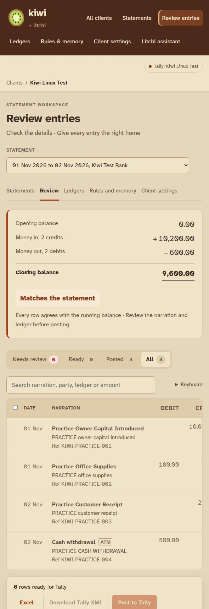

> For this repo package, unzip or clone it and run the scripts from the extracted `kiwi-litchi` directory — the older USB ZIP filename below is historical

# Kiwi + Litchi — Linux Mint edition

Kiwi imports and checks bank statements, learns ledger corrections, and prepares Payment, Receipt and Contra vouchers. Litchi adds client-specific ledger suggestions, audit signals, questions over imported Tally books, and source-backed law retrieval. Both share a local password and one web address.

This package builds on the supplied Bahi 1.0.0 source and preserves its original 109 automated tests. Internal `bahi` names remain for compatibility. The public bookkeeping command is `kiwi`. This is a working pilot: real TallyPrime, your bank layouts, legal quality and performance on your i3 still require the acceptance checks in [docs/ACCEPTANCE.md](ACCEPTANCE.md). Software tests alone do not establish those results.

## 1. Transfer to your Linux laptop

Copy `kiwi-litchi-linux.zip` using a USB drive or your preferred file transfer. On **Linux Mint**, open Terminal with Ctrl+Alt+T:

```bash
cat /etc/linuxmint/info
python3 --version
lsblk -d -o NAME,SIZE,ROTA
free -h
```

The installer requires Python 3.10 or newer, such as Mint 21/22. Commands below assume the ZIP is in Downloads. Internet is needed for initial dependencies and model downloads; client processing uses local services afterwards.

```bash
sudo apt update
sudo apt install -y python3-venv python3-pip tesseract-ocr poppler-utils unzip curl
mkdir -p ~/Apps
unzip ~/Downloads/kiwi-litchi-linux.zip -d ~/Apps
cd ~/Apps/kiwi-litchi-linux
bash scripts/install-linux.sh
```

Run the installer as your regular user. It creates a virtual environment, installs dependencies, runs all tests, loads the original 47-row demo, and asks you to choose a password of at least 12 characters. It stops if tests fail. Read the first error before retrying; do not bypass it.

## 2. Open the workspace

```bash
cd ~/Apps/kiwi-litchi-linux
bash scripts/run.sh
```

Open **http://127.0.0.1:8765** in Firefox on the Linux laptop. Sign in with the password you chose. Keep the terminal open; Ctrl+C stops the app.

Open **Sharma Traders (Demo)** and **Review**. You should see 47 transactions, with 16 needing review and 31 ready. Check the balance summary, search rows, choose a ledger, and see the correction remembered. The sidebar opens **Litchi assistant**. Its posted-book count starts at zero: unposted bank rows are never counted as Tally books.

## 3. Add your own client

Use **All clients → Add client**, then upload one statement. In **Client settings**, choose the bank account's exact Tally bank ledger and company name. Review every flagged row before exporting. Kiwi's parsing remains deterministic; Ollama is unnecessary for this workflow.

Start with XML export into a disposable Tally company. Follow [the real-Tally checklist](TALLY-TEST.md) before live posting. TallyPrime must be running on a reachable machine; this Linux package does not include TallyPrime or a Windows VM.

## 4. Enable Litchi's local models

Follow [AI setup](AI-SETUP.md). The configured models are:

- `llama3.2:1b-instruct-q4_K_M` — short structured intents and exact source quotations.
- `nomic-embed-text` — embeddings for historical postings and law passages.
- sqlite-vec — client vectors inside each client's SQLite database.
- Qdrant — law vectors, bound to localhost, Docker limited to 512 MB.

Import native Tally ledger/voucher XML from **Litchi → Ask your books**. Then:

```bash
source .venv/bin/activate
litchi clients
litchi embed kiwi-1
litchi batch --embeddings
```

Use the actual client ID printed by `litchi clients`; `kiwi-1` is the installed demo. Suggestions appear under **Ledger predictions** and apply through Kiwi's existing correction memory. Firm rules, previous corrections and own-account handling keep priority. Every model suggestion still requires human approval.

Book questions support Payment and Receipt totals with dates and voucher evidence. Try an exact ledger name plus `FY 2026-27`, or use the explicit ledger/date fields. Check **Use local Ollama for intent** for model routing. All totals come from fixed, parameterized SQL with integer paise.

The law library starts empty. Supply verified, dated legal sources as described in [LAW-LIBRARY.md](LAW-LIBRARY.md). The fictional example is only for testing; it is excluded from normal search.

## 5. Keep it running

After the manual workflow works, stop the foreground server with Ctrl+C and install user services:

```bash
bash scripts/install-services.sh --embeddings
systemctl --user status kiwi-web.service
systemctl --user list-timers
```

Omit `--embeddings` until Ollama is ready. The schedules use the laptop's local time: backup 00:30, statement regression 00:45, Litchi 01:00 with a five-hour timeout. Watch folders scan every minute. To run while logged out, explicitly enable your user's boot services:

```bash
sudo loginctl enable-linger "$USER"
```

See [OPERATIONS.md](OPERATIONS.md) for logs, watch folders, backups and restore. [VALIDATION.md](VALIDATION.md) records what was actually tested.

## Screens




