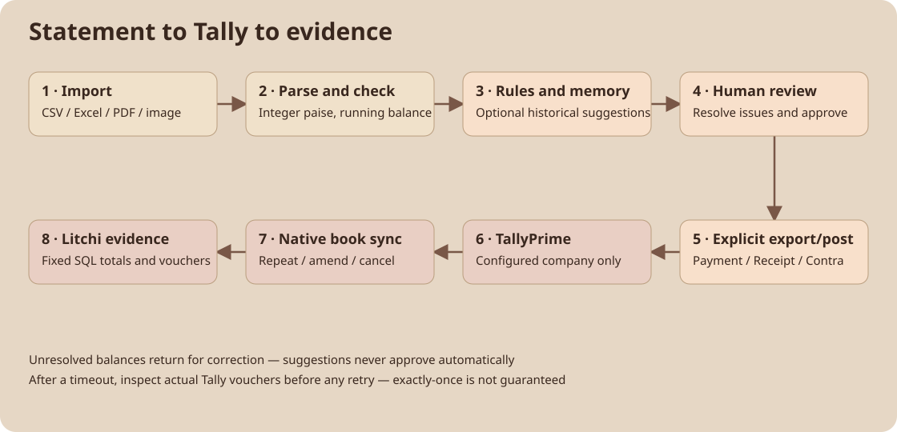
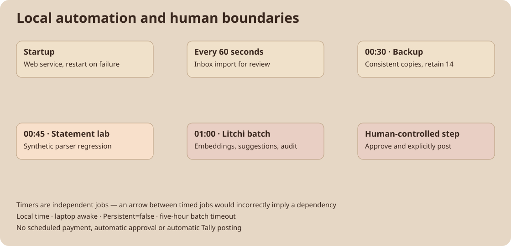
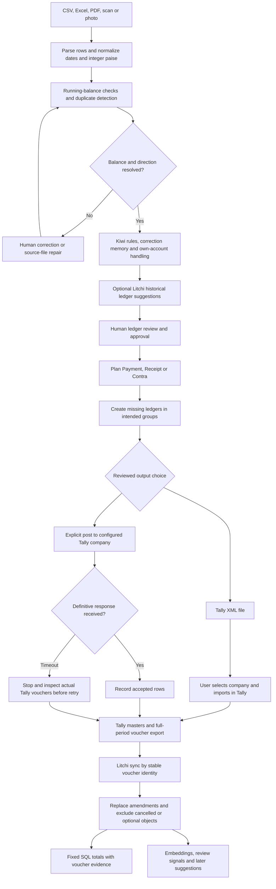
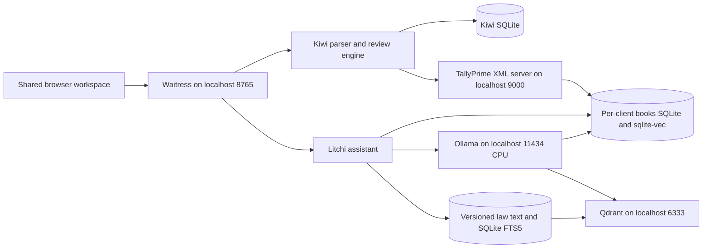
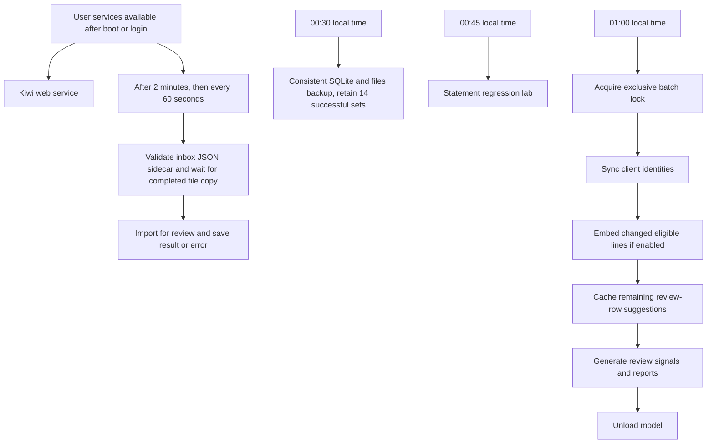

# Workflow and automation map

## From statement to evidence

A watcher or model suggestion never approves a voucher or moves money automatically

## Local architecture

The LLM routes supported questions — arithmetic comes from SQL, and legal passages come from a separately loaded verified corpus

## Scheduled automation

| Job | Schedule | Boundaries |
|---|---|---|
| `kiwi-web.service` | Enabled user startup service | Restart on failure after 5 seconds |
| `kiwi-watch.timer` | OnBootSec=2min, then OnUnitActiveSec=60s | Inbox sidecar workflow, no silent posting |
| `kiwi-backup.timer` | 00:30 local time | Last 14 successful backup sets retained |
| `kiwi-lab.timer` | 00:45 local time | Synthetic parser regression report |
| `litchi-batch.timer` | 01:00 local time | Optional embeddings, cached suggestions, audit, report |

Generated services set MemoryMax=2G, Nice=10, UMask=0077, PrivateTmp and NoNewPrivileges — batch jobs have a five-hour timeout

Timers use Persistent=false, so a missed scheduled job is not replayed on wake — the laptop must be awake, and running while logged out depends on user lingering being enabled

Qdrant is separately limited to 512 MiB — a web/batch service limit is not a cap on total system RAM or the separate Ollama service

[Operating guide](OPERATIONS.md) · [Timer generator](../scripts/write-services.py) · [Batch/watch implementation](../kiwi_litchi/operations.py)
